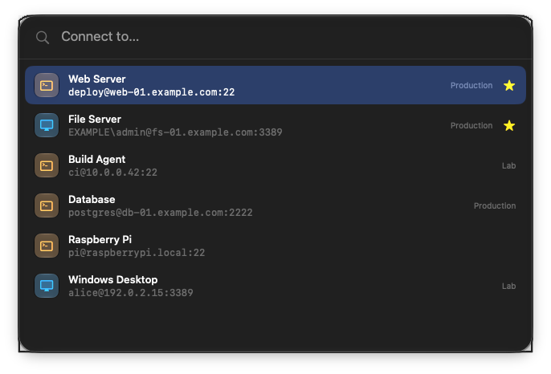
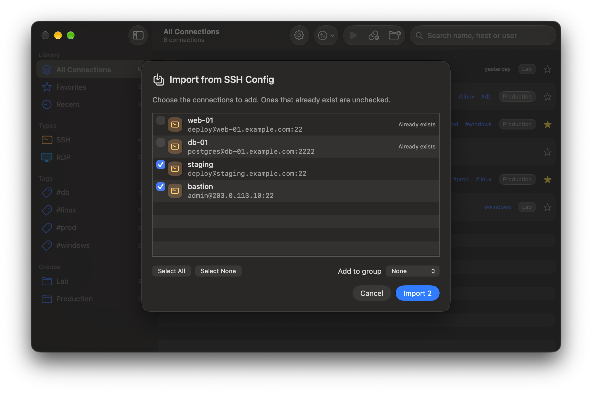

# CoreRemote

[Türkçe](README.md) | **English**

A simple SSH and RDP connection manager for macOS. Save your connections and open them with a double-click.


## Features

- **SSH**: Connections open in Terminal or iTerm2, chosen in Settings. A saved password is entered for you; an SSH key file can be chosen per connection. "File Transfer" in a connection's menu opens the server in an app such as Cyberduck, Transmit or ForkLift, or with sftp in the terminal if none is installed. When sudo needs the password, "Copy Password" in a connection's menu (⇧⌘C) copies it, or Settings > SSH can copy it after every connection.
- **RDP**: The default client is [FreeRDP](https://www.freerdp.com), which receives the password directly. [Microsoft Windows App](https://apps.apple.com/app/id1295203466) can be chosen in Settings instead. Display (window size or full screen, all screens), clipboard, shared folder and sound have defaults in Settings and can be changed per connection; resizing the window updates the resolution or, for older servers, scales the picture. A shared folder works with FreeRDP only. When FreeRDP can't connect, an alert says why (account locked, wrong password, server unreachable and so on). FreeRDP's shortcuts use left Control + Option + Shift (M minimizes, Enter toggles full screen, D disconnects), so typing a capital letter with right Shift doesn't trigger them. This is set in `~/.config/freerdp/sdl-freerdp.json`, which is created unless you already chose your own keys there.
- **Groups, favorites and order**: Sort connections into groups, mark the ones you use most, and search by name, host or user. Order the list by hand (drag and drop), by name or by last connection.
- **Credential profiles**: Define a shared user name and password, such as a domain account, once in Settings > Credentials and use it for several connections. When the password changes, update it in one place. Passwords stay in the Keychain; backups include profile names and user names, not their passwords.
- **Notes and tags**: Add notes and tags such as `prod` or `linux` to any connection. Tags are listed in the sidebar, and search covers notes and tags too.
- **Recent**: The 10 connections you opened last are listed in the sidebar, and each row shows when you last connected. History can be cleared in Settings.
- **Menu bar**: Connect to favorites, the last 5 connections and groups straight from the menu bar. CoreRemote keeps running there after you close its window; the icon can be hidden in Settings.
- **Quick connect**: Press **⌃⌥Space** in any app to open a search box, type a name, host or user and press Return to connect. The shortcut can be changed in Settings.
- **Server status**: While the window is open, each server's port is tried every minute and its row shows a green (reachable) or red (unreachable) dot, with the reason on hover. Can be turned off in Settings.
- **Spotlight and Shortcuts**: Search a connection's name in Spotlight and pick it to connect. In the Shortcuts app, CoreRemote's "Connect" action builds a shortcut for any connection that you can add to the menu bar or give a keyboard shortcut.
- **Import**: Bring in Host entries from `~/.ssh/config` or `.rdp` files (pick them or drop them on the window). A preview comes first, and connections that already exist start unchecked.
- **Backup**: Export your connections to a `.coreremote` file and import them on another Mac. Passwords are only included in passphrase-encrypted backups.
- **Liquid Glass** interface, in English and Turkish.






## Security

- Passwords are stored only in this Mac's **Keychain**. There is no cloud sync; nothing leaves the device.
- **SSH** passwords are handed over through `SSH_ASKPASS`. The password is written to a one-time file that only you can read, and the file is deleted on first read. It never appears on the command line or in shell history.
- **FreeRDP** reads the password from standard input (`/args-from:stdin`), so it doesn't show up in the process list.
- **Windows App** doesn't accept a password from outside. The password is copied to the clipboard and cleared after 30 seconds.
- **Copy Password** (for sudo) keeps the password on the clipboard for 90 seconds. Copied passwords are marked as concealed (`org.nspasteboard.ConcealedType`) so clipboard managers leave them out of their history; anything you copy in the meantime is left alone.
- **Host keys**: SSH accepts new host keys on first connection and rejects changed ones (`StrictHostKeyChecking=accept-new`). FreeRDP follows the same rule for certificates (`/cert:tofu`).

## Requirements

- macOS 26 (Tahoe) or later
- For RDP, FreeRDP:
  ```bash
  brew install freerdp
  ```
  or Microsoft Windows App:
  ```bash
  brew install --cask windows-app
  ```

## Installation

### Homebrew

```bash
brew install meteciftci/tap/coreremote
```

Update with `brew upgrade coreremote`. Because the app isn't notarized by Apple, the cask removes the quarantine flag after installing, so macOS doesn't block it on launch. Installing from this tap is how you agree to that.

`brew uninstall --zap coreremote` also removes connections, settings and logs. Passwords stay in the Keychain; search for "CoreRemote" in Keychain Access to delete them.

### Prebuilt release

1. Download the latest `CoreRemote-x.y.z.zip` from the [Releases](https://github.com/meteciftci/core-remote/releases) page, unzip it, and move `CoreRemote.app` to your **Applications** folder.
2. The app isn't notarized by Apple, so macOS blocks it on first launch. Open it either way:
   - **Right-click the app and choose Open**. If it still won't open, click **Open Anyway** in **System Settings → Privacy & Security**.
   - Or remove the quarantine flag in Terminal:
     ```bash
     xattr -dr com.apple.quarantine /Applications/CoreRemote.app
     ```

Prebuilt releases are ad-hoc signed, so macOS asks for Keychain and Accessibility access again after each update.

### Building from source

Requires Xcode 26 or later and [XcodeGen](https://github.com/yonaskolb/XcodeGen).

```bash
brew install xcodegen
git clone https://github.com/meteciftci/core-remote.git
cd core-remote
xcodegen generate
open CoreRemote.xcodeproj
```

`CoreRemote.xcodeproj` is generated from `project.yml` and isn't checked in. Run `xcodegen generate` again after adding files.

Run the tests from the command line:

```bash
xcodebuild -project CoreRemote.xcodeproj -scheme CoreRemote test
```

#### Sample data

A Debug build launched with `-DemoData` shows in-memory sample connections instead of your real ones. The README screenshots were taken this way; `-DemoEditor` and `-DemoSettings` also open those screens.

```bash
open build/Build/Products/Debug/CoreRemote.app --args -DemoData
```

#### Signing

By default the app is ad-hoc signed ("Sign to Run Locally"), so no Apple account is needed. macOS then asks for Keychain and Accessibility access again after every build. To keep those permissions, sign with your Apple Development certificate:

```bash
cp Config/Local.xcconfig.example Config/Local.xcconfig
```

Then set `DEVELOPMENT_TEAM` in `Config/Local.xcconfig` to your team ID. That file isn't checked in.

## Usage

| Shortcut | Action |
| --- | --- |
| Double-click or Return | Connect to the selected connection |
| ⌃⌥Space | Quick connect (from any app) |
| ⌘N | New connection |
| ⇧⌘N | New group |
| ⌘F | Search |
| ⇧⌘I / ⇧⌘E | Import / Export |
| ⌘, | Settings |


## Known limitations

- FreeRDP 3.x briefly opens a fullscreen window on each display at startup to measure it, so the screen flashes black for a moment when connecting.
- Closing an RDP window with its close button disconnects the session but doesn't sign out. Use **Sign out** in Windows to end the session.

## License

[MIT](LICENSE)
