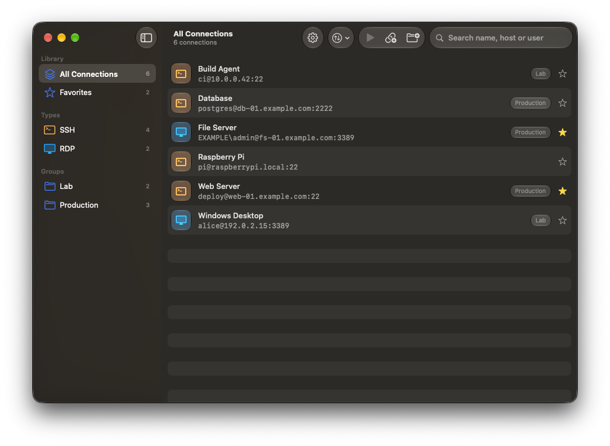
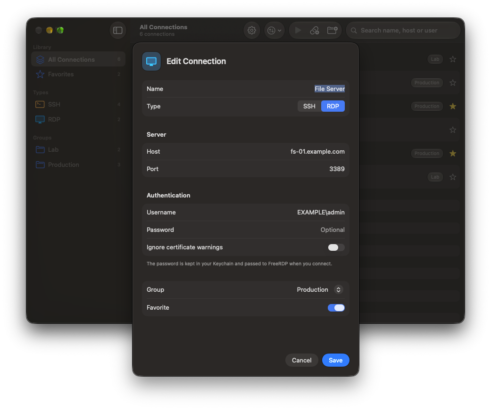
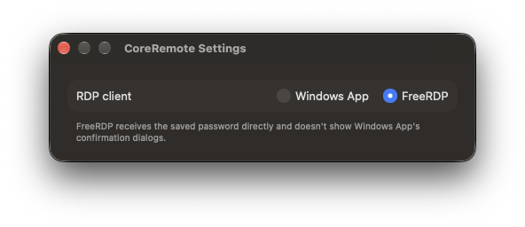

# CoreRemote

[Türkçe](README.md) | **English**

A simple SSH and RDP connection manager for macOS. Save your connections and open them with a double-click.



## Features

- **SSH**: Connections open in Terminal. A saved password is entered for you; an SSH key file can be chosen per connection.
- **RDP**: The default client is [FreeRDP](https://www.freerdp.com), which receives the password directly. [Microsoft Windows App](https://apps.apple.com/app/id1295203466) can be chosen in Settings instead.
- **Groups and favorites**: Sort connections into groups, mark the ones you use most, and search by name, host or user.
- **Backup**: Export your connections to a `.coreremote` file and import them on another Mac. Passwords are only included in passphrase-encrypted backups.
- **Liquid Glass** interface, in English and Turkish.



## Security

- Passwords are stored only in this Mac's **Keychain**. There is no cloud sync; nothing leaves the device.
- **SSH** passwords are handed over through `SSH_ASKPASS`. The password is written to a one-time file that only you can read, and the file is deleted on first read. It never appears on the command line or in shell history.
- **FreeRDP** reads the password from standard input (`/args-from:stdin`), so it doesn't show up in the process list.
- **Windows App** doesn't accept a password from outside. The password is copied to the clipboard and cleared after 30 seconds.
- **Host keys**: SSH accepts new host keys on first connection and rejects changed ones (`StrictHostKeyChecking=accept-new`). FreeRDP follows the same rule for certificates (`/cert:tofu`).

## Requirements

- macOS 26 (Tahoe) or later
- For RDP, FreeRDP:
  ```bash
  brew install freerdp
  ```
  or Microsoft Windows App:
  ```bash
  brew install --cask windows-app
  ```

## Installation

### Prebuilt release

1. Download the latest `CoreRemote-x.y.z.zip` from the [Releases](https://github.com/meteciftci/core-remote/releases) page, unzip it, and move `CoreRemote.app` to your **Applications** folder.
2. The app isn't notarized by Apple, so macOS blocks it on first launch. Open it either way:
   - **Right-click the app and choose Open**. If it still won't open, click **Open Anyway** in **System Settings → Privacy & Security**.
   - Or remove the quarantine flag in Terminal:
     ```bash
     xattr -dr com.apple.quarantine /Applications/CoreRemote.app
     ```

Prebuilt releases are ad-hoc signed, so macOS asks for Keychain and Accessibility access again after each update.

### Building from source

Requires Xcode 26 or later and [XcodeGen](https://github.com/yonaskolb/XcodeGen).

```bash
brew install xcodegen
git clone https://github.com/meteciftci/core-remote.git
cd core-remote
xcodegen generate
open CoreRemote.xcodeproj
```

`CoreRemote.xcodeproj` is generated from `project.yml` and isn't checked in. Run `xcodegen generate` again after adding files.

Run the tests from the command line:

```bash
xcodebuild -project CoreRemote.xcodeproj -scheme CoreRemote test
```

#### Sample data

A Debug build launched with `-DemoData` shows in-memory sample connections instead of your real ones. The README screenshots were taken this way; `-DemoEditor` and `-DemoSettings` also open those screens.

```bash
open build/Build/Products/Debug/CoreRemote.app --args -DemoData
```

#### Signing

By default the app is ad-hoc signed ("Sign to Run Locally"), so no Apple account is needed. macOS then asks for Keychain and Accessibility access again after every build. To keep those permissions, sign with your Apple Development certificate:

```bash
cp Config/Local.xcconfig.example Config/Local.xcconfig
```

Then set `DEVELOPMENT_TEAM` in `Config/Local.xcconfig` to your team ID. That file isn't checked in.

## Usage

| Shortcut | Action |
| --- | --- |
| Double-click or Return | Connect to the selected connection |
| ⌘N | New connection |
| ⇧⌘N | New group |
| ⌘F | Search |
| ⇧⌘I / ⇧⌘E | Import / Export |
| ⌘, | Settings |



## Known limitations

- FreeRDP 3.x briefly opens a fullscreen window on each display at startup to measure it, so the screen flashes black for a moment when connecting.
- Closing an RDP window with its close button disconnects the session but doesn't sign out. Use **Sign out** in Windows to end the session.

## License

[MIT](LICENSE)
