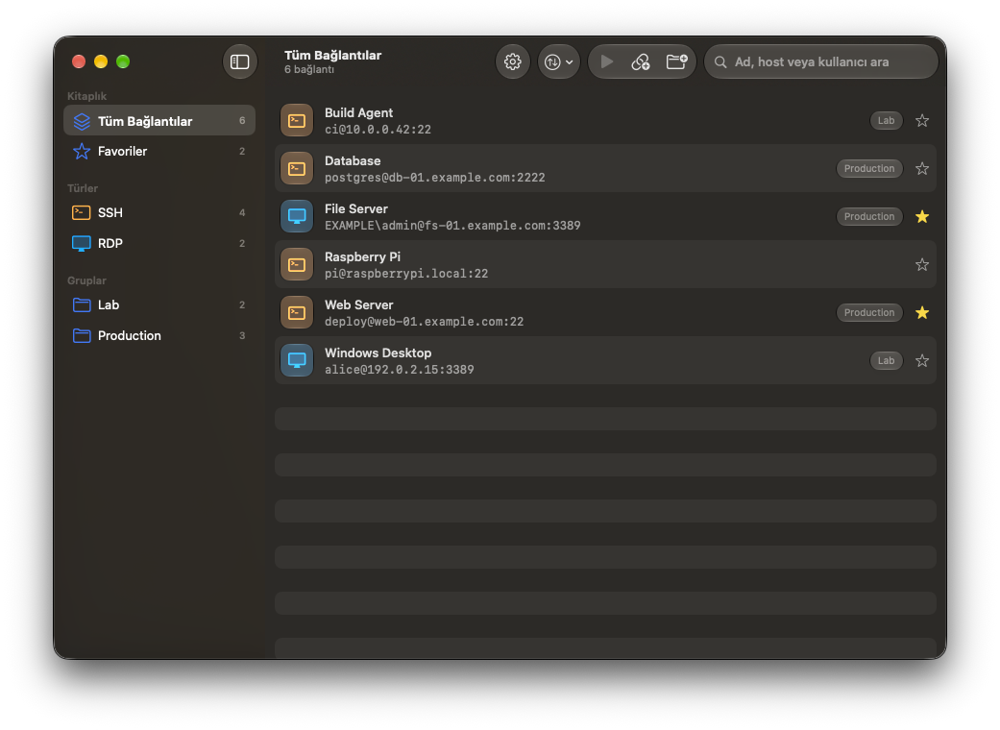
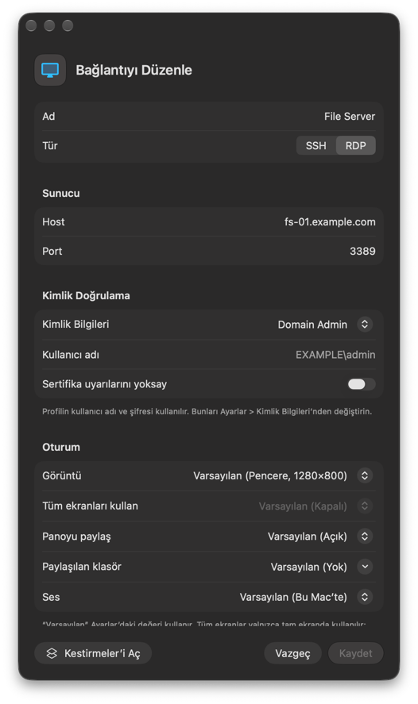
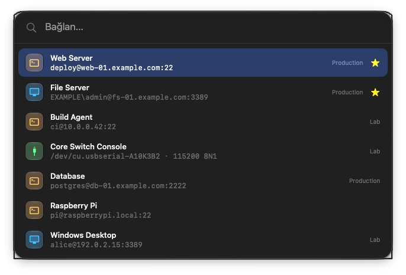
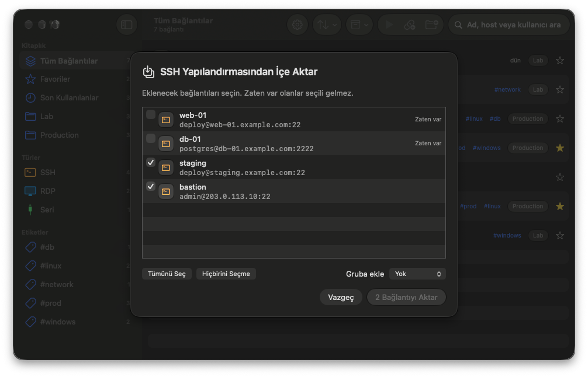
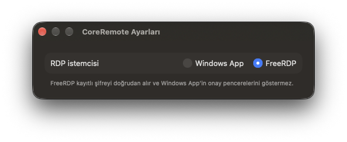

# CoreRemote

**Türkçe** | [English](README.en.md)

macOS için sade bir SSH ve RDP bağlantı yöneticisi. Bağlantılarınızı kaydedin, çift tıklayarak bağlanın.



## Özellikler

- **SSH**: Bağlantı Terminal ya da iTerm2'de açılır; hangisinin kullanılacağı Ayarlar'da seçilir. Kayıtlı şifre otomatik girilir; isteğe bağlı SSH anahtar dosyası seçilebilir. Bağlantı menüsündeki "Dosya Aktarımı" sunucuyu Cyberduck, Transmit ya da ForkLift gibi bir uygulamada, bunlar yoksa terminalde sftp ile açar.
- **RDP**: Varsayılan istemci [FreeRDP](https://www.freerdp.com)'dir ve şifreyi doğrudan alır. İsterseniz Ayarlar'dan [Microsoft Windows App](https://apps.apple.com/app/id1295203466) seçilebilir.
- **Gruplar ve favoriler**: Bağlantıları gruplara ayırın, sık kullandıklarınızı favorilere ekleyin, ad, host veya kullanıcıya göre arayın.
- **Notlar ve etiketler**: Her bağlantıya not ve `prod`, `linux` gibi etiketler ekleyin. Etiketler kenar çubuğunda listelenir; arama notları ve etiketleri de kapsar.
- **Son Kullanılanlar**: En son açtığınız 10 bağlantı kenar çubuğunda listelenir; her satırda ne zaman bağlandığınız görünür. Geçmiş Ayarlar'dan temizlenebilir.
- **Menü çubuğu**: Favorilere, son 5 bağlantıya ve gruplara menü çubuğundan tek tıkla bağlanın. Pencere kapatılınca CoreRemote menü çubuğunda çalışmaya devam eder; simge Ayarlar'dan gizlenebilir.
- **Hızlı bağlan**: Hangi uygulamada olursanız olun **⌃⌥Space** ile bir arama kutusu açın, ad, host veya kullanıcı yazıp Return ile bağlanın. Kısayol Ayarlar'dan değiştirilebilir.
- **Sunucu durumu**: Pencere açıkken her sunucunun portu dakikada bir denenir; satırda yeşil (ulaşılabilir) ya da kırmızı (ulaşılamıyor) bir nokta görünür, üzerine gelince nedeni yazar. Ayarlar'dan kapatılabilir.
- **Spotlight ve Kestirmeler**: Bağlantının adını Spotlight'ta arayıp seçince bağlanır. Kestirmeler'de CoreRemote'un "Bağlan" eylemiyle her bağlantı için kestirme oluşturabilir, menü çubuğuna ekleyebilir ya da klavye kısayolu atayabilirsiniz.
- **İçe aktarma**: `~/.ssh/config` içindeki Host girdilerini ya da `.rdp` dosyalarını (seçerek veya pencereye sürükleyip bırakarak) içe aktarın. Önce bir önizleme gösterilir; zaten var olan bağlantılar seçili gelmez.
- **Yedekleme**: Bağlantılarınızı `.coreremote` dosyasına dışa aktarın, başka bir Mac'e içe aktarın. Şifreler yalnızca parolayla şifrelenmiş yedeğe eklenir.
- **Liquid Glass** arayüzü, Türkçe ve İngilizce dil desteği.







## Güvenlik

- Şifreler yalnızca bu Mac'in **Anahtar Zinciri**'nde saklanır. Bulut senkronizasyonu yoktur; hiçbir veri cihazdan çıkmaz.
- **SSH** şifresi `SSH_ASKPASS` ile iletilir. Şifre, yalnızca sizin okuyabildiğiniz tek kullanımlık bir dosyaya yazılır ve ilk okumada silinir. Komut satırında veya terminal geçmişinde görünmez.
- **FreeRDP** şifreyi standart girdiden (`/args-from:stdin`) alır, bu yüzden işlem listesinde görünmez.
- **Windows App** dışarıdan şifre kabul etmez. Şifre panoya kopyalanır ve 30 saniye sonra silinir.
- **Sunucu anahtarları**: SSH yeni sunucu anahtarlarını ilk bağlantıda kabul eder, değişmiş anahtarları reddeder (`StrictHostKeyChecking=accept-new`). FreeRDP sertifikalarda aynı mantığı izler (`/cert:tofu`).

## Gereksinimler

- macOS 26 (Tahoe) veya üzeri
- RDP için FreeRDP:
  ```bash
  brew install freerdp
  ```
  ya da Microsoft Windows App:
  ```bash
  brew install --cask windows-app
  ```

## Kurulum

### Hazır sürüm

1. [Releases](https://github.com/meteciftci/core-remote/releases) sayfasından son `CoreRemote-x.y.z.zip` dosyasını indirin, açın ve `CoreRemote.app`'i **Uygulamalar** klasörüne taşıyın.
2. Uygulama Apple tarafından onaylanmadığı (notarize edilmediği) için macOS ilk açılışta engeller. İki yoldan biriyle açabilirsiniz:
   - Uygulamaya **sağ tıklayıp Aç**'ı seçin. Açılmazsa **Sistem Ayarları → Gizlilik ve Güvenlik** bölümünde **Yine de Aç**'a basın.
   - Ya da Terminal'de karantina işaretini kaldırın:
     ```bash
     xattr -dr com.apple.quarantine /Applications/CoreRemote.app
     ```

Hazır sürüm yerel imzalıdır. Bu yüzden her güncellemeden sonra macOS, Anahtar Zinciri ve Erişilebilirlik izinlerini bir kez daha sorar.

### Kaynak koddan derleme

Xcode 26 veya üzeri ile [XcodeGen](https://github.com/yonaskolb/XcodeGen) gerekir.

```bash
brew install xcodegen
git clone https://github.com/meteciftci/core-remote.git
cd core-remote
xcodegen generate
open CoreRemote.xcodeproj
```

`CoreRemote.xcodeproj`, `project.yml` dosyasından üretilir ve depoya eklenmez. Yeni bir dosya ekledikten sonra `xcodegen generate` komutunu tekrar çalıştırın.

Testleri komut satırından çalıştırmak için:

```bash
xcodebuild -project CoreRemote.xcodeproj -scheme CoreRemote test
```

#### Örnek veriler

Debug derlemesi `-DemoData` argümanıyla açılırsa gerçek bağlantılar yerine yalnızca hafızada tutulan örnek bağlantılar gösterilir. README ekran görüntüleri bu şekilde alınmıştır; `-DemoEditor` ve `-DemoSettings` ilgili ekranı da açar.

```bash
open build/Build/Products/Debug/CoreRemote.app --args -DemoData
```

#### İmza

Varsayılan olarak uygulama yerel imzayla ("Sign to Run Locally") derlenir; Apple hesabı gerekmez. Bu durumda macOS her derlemeden sonra Anahtar Zinciri ve Erişilebilirlik izinlerini yeniden sorar. İzinlerin kalıcı olması için Apple Development sertifikanızla imzalayın:

```bash
cp Config/Local.xcconfig.example Config/Local.xcconfig
```

Ardından `Config/Local.xcconfig` içindeki `DEVELOPMENT_TEAM` değerini kendi ekip ID'nizle değiştirin. Bu dosya git'e eklenmez.

## Kullanım

| Kısayol | İşlem |
| --- | --- |
| Çift tıklama veya Return | Seçili bağlantıya bağlan |
| ⌃⌥Space | Hızlı bağlan (her uygulamadan) |
| ⌘N | Yeni bağlantı |
| ⇧⌘N | Yeni grup |
| ⌘F | Ara |
| ⇧⌘I / ⇧⌘E | İçe aktar / Dışa aktar |
| ⌘, | Ayarlar |



## Bilinen kısıtlar

- FreeRDP 3.x, açılışta ekranları ölçmek için kısa süreliğine tam ekran bir pencere açar. Bu yüzden bağlanırken ekran bir an siyaha döner.
- RDP oturumunu pencerenin çarpısıyla kapatmak oturumu kapatmaz, yalnızca bağlantıyı keser. Oturumu sonlandırmak için Windows'ta **Oturumu kapat**'ı kullanın.

## Lisans

[MIT](LICENSE)
